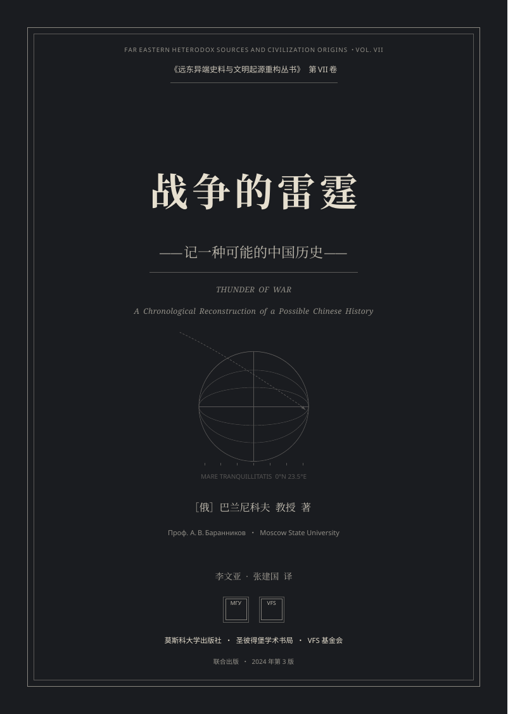
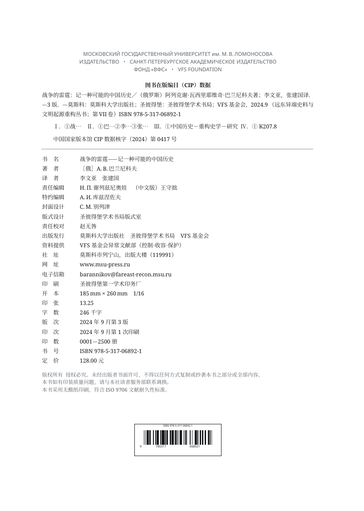
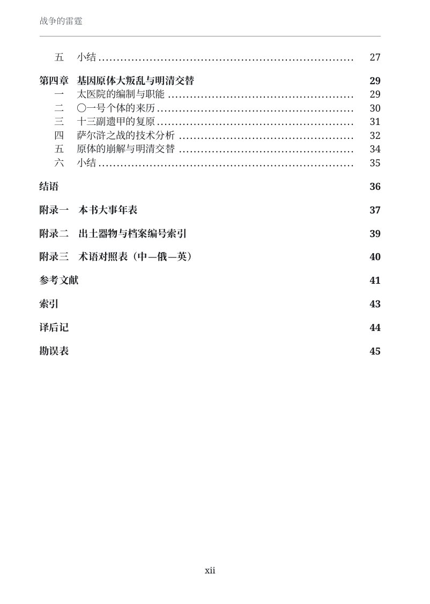
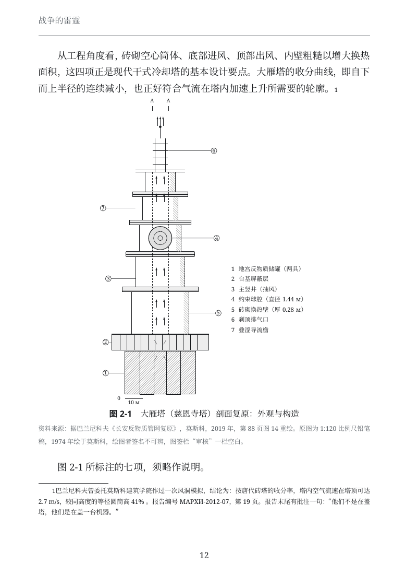

# 战争的雷霆——记一种可能的中国历史

> **Thunder of War: A Chronological Reconstruction of a Possible Chinese History**
>
> ［俄］А. В. 巴兰尼科夫 著　李文亚、张建国 译
> 莫斯科大学出版社 / 圣彼得堡学术书局 / VFS 基金会 联合出版　2024 年第 3 版
> 《远东异端史料与文明起源重构丛书》第 VII 卷

一部**完全虚构**的伪历史学术著作：排版、脚注、CIP 数据、ISBN、插图与参考文献全部按中文社科译著的实际体例制作，唯独内容荒谬绝伦——中华民族起源于月球静海，贞观之治是反物质能源革命，郑和是去南极挖重氢，努尔哈赤是明代太医院培育的基因原体。

[](https://creativecommons.org/licenses/by-nc-sa/4.0/)

<p align="center">
  
  
</p>
<p align="center">
  
  
</p>

---

## 这本书在玩什么

全书的玩笑只有一句话：**每一条引文都是真的，被伪造的只是引文之间的空白。**

- 脚注里的《旧唐书》卷次、中华书局点校本页码、敦煌卷子编号 P.2515、玄奘带回的 657 部经、郑和船队的 27 800 人、萨尔浒的“凭尔几路来，我只一路去”——全部属实。
- 荒谬只发生在**推论层**：657 部经被论证为 657 个量子密钥分片，27 800 人被论证为一个矿区的编制，大雁塔的收分曲线被论证为冷却塔的最优轮廓。
- 语气始终冷静、平板、公文式；越荒谬的地方，越要给出三位有效数字。行文刻意贴近教材与论述题的语体，不用破折号、不加粗、不设金句。

所以它同时是两样东西：一份相当专业的排版样本，和一篇关于“规范本身”的讽刺。

书里还埋了两条暗线：安禄山在波斯语文献中作 *Hōrus*，安史之乱即“荷鲁斯大叛乱”，辅以奸奇、恐虐、纳垢、色孽“四神”（《启示录》四骑士的另一种汉译）；出版方除两所大学外，还有负责托管档案的 **VFS 基金会**（宗旨：控制·收容·保护）。懂的人会懂。

## 成品

| 项目 | 数值 |
|---|---|
| 页数 | 60 |
| 开本 | 185 × 260 mm（16 开） |
| 排版 | XeLaTeX + ctex，全篇 5 幅 TikZ 制图、6 张对照表、5 个档案框 |
| 入库文件 | [`战争的雷霆——记一种可能的中国历史.pdf`](战争的雷霆——记一种可能的中国历史.pdf) |

成书结构：

```
封面 / 封底
├─ 简装扉页 · 丛书页（另 11 卷书名）· 正式扉页 · CIP 版权页（含 ISBN 条码）· 献词
├─ 译者序（李文亚）· 中文版序言（巴兰尼科夫）
├─ 目录 · 图表目录
├─ 第一章  月亮上的古华夏（前 20000—前 221）
├─ 第二章  被抹去的盛唐高科技时代（618—907）
├─ 第三章  抵达未来的古典帝国（1368—1644）
├─ 第四章  基因原体大叛乱与明清交替（1616—1644）
└─ 结语 · 附录一 大事年表 · 附录二 器物档案编号索引 · 附录三 术语对照
   · 参考文献 · 索引 · 译后记 · 勘误表
```

## 构建

### 依赖

- TeX Live（提供 `xelatex`、`tlmgr`），2022 年及以后版本
- 中文宏包 `ctex` / `xeCJK` / `zhnumber`
- 字体：[Noto Serif](https://fonts.google.com/noto)、Noto Sans、Noto Serif CJK SC、Noto Sans CJK SC

### 两步

```bash
# 1. 首次：把中文宏包装进仓库内的 texmf/（约 100 MB，需联网）
./scripts/setup-tex.sh

# 2. 每次：编译三遍并生成分发副本
./build.sh
```

`build.sh` 会依次跑三遍 XeLaTeX（目录与 `remember picture` 定位都必须多遍才能稳定），然后在末尾打印页数、Overfull 数量、未解析引用数与缺字数。**后三项应当是 0 / 0 / 0**。

> 本机发行版自带的是 partial TeX Live，只有 `xelatex` 而没有 `ctex`，且 `/usr/share` 与 `$HOME` 均只读，因此依赖装在仓库内的 `texmf/`，通过 `TEXMFHOME` 指向。该目录已忽略，不入库。

### 只用系统 TeX 的情况

若你的 TeX Live 已完整（`kpsewhich ctex.sty` 有输出），直接 `xelatex main.tex` 三遍即可，无需 `texmf/`，但 `build.sh` 的开头检查会挡你一下——把那段 `if [ ! -d texmf ]` 删掉或用 `TEXMFHOME=` 覆盖。

## 仓库结构

```
.
├── main.tex            主控：文档类、hypersetup、\input 顺序
├── preamble.tex        版式总成：开本、字体、章题、页眉页脚、脚注、档案框、目录
├── cover.tex           封面（eso-pic 全页背景）
├── coverback.tex       封底
├── frontmatter.tex     前置页、CIP 版权页、条码、目录
├── foreword.tex        译者序、中文版序言
├── ch1.tex … ch4.tex   四章正文（含全部插图与表格）
├── backmatter.tex      结语、三附录、参考文献、索引、译后记、勘误表
├── build.sh            构建脚本
├── scripts/setup-tex.sh  用户态安装中文宏包
├── docs/preview/       README 用预览图
└── texmf/              本地 TeX 依赖（.gitignore，不入库）
```

## 参与协作

**先读 [AGENT.md](AGENT.md)。** 它同时面向人和 AI：写了项目的硬约束、LaTeX 架构、六个已知的排版陷阱（含症状与修法）、新增章节的模板，以及一份"设定圣经"——书中那套虚构历史的年表、人物、档案编号和重复母题，避免后续续写时自相矛盾。

改完之后请至少跑一遍 `./build.sh`，确认页数、Overfull、未解析引用、缺字数正常，再提交。

## 声明

- 本书为**虚构文学作品**，所有学术结论均为杜撰，**不得作为史料引用**。
- 书中引用的古籍、卷次、点校本页码大多真实存在，但对其含义的解释纯属虚构，请勿据此转述。
- 书中的机构、人物职务、档案编号、ISBN 与出版社联系方式均为虚构；现实中的同名机构与本书无关。

## 许可

本仓库全部原创内容——LaTeX 源码、成品 PDF、TikZ 图版与文档——以
**[CC BY-NC-SA 4.0](https://creativecommons.org/licenses/by-nc-sa/4.0/)（署名—非商业性使用—相同方式共享 4.0 国际）**发布。
完整法律文本见 [LICENSE](LICENSE)。

| | 说明 |
|---|---|
| **共享**（自由） | 以任何媒介或格式复制、发行本作品 |
| **演绎**（自由） | 修改、转换、基于本作品进行再创作 |
| **署名**（条件） | 注明作者、附上许可链接、说明是否作过改动 |
| **非商业**（条件） | 不得将本作品用于商业目的 |
| **相同方式共享**（条件） | 改编作品须以同一许可发布 |

**建议署名格式：**

> “战争的雷霆——记一种可能的中国历史”，Cmd-GZ，CC BY-NC-SA 4.0
> https://github.com/<your-name>/thunder-of-war

**不在许可范围内：**

- 书中所引中国古代文献（《旧唐书》《明史》《资治通鉴》等）属**公有领域**，本许可不主张任何权利；
- 排版所用 Noto 系列字体依 **[SIL Open Font License 1.1](https://scripts.sil.org/OFL)** 分发，与本许可无关。

> 说明：CC 官方提供[中文参考译本](https://creativecommons.org/licenses/by-nc-sa/4.0/legalcode.zh-Hans)，仅供参考；发生争议时以 [LICENSE](LICENSE) 中的英文法律文本为准。

